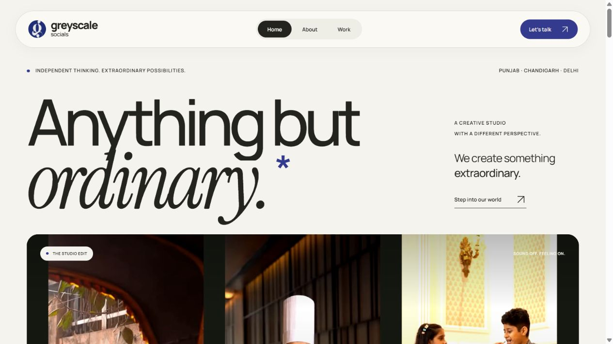
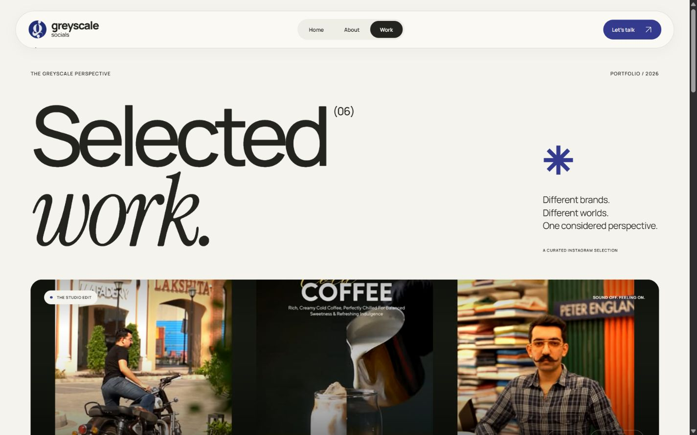
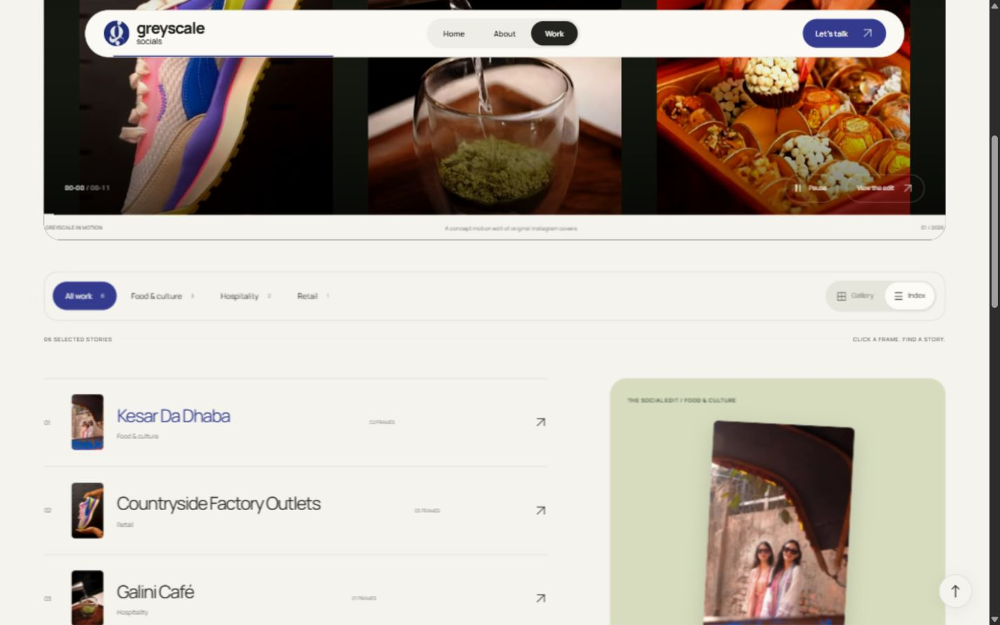
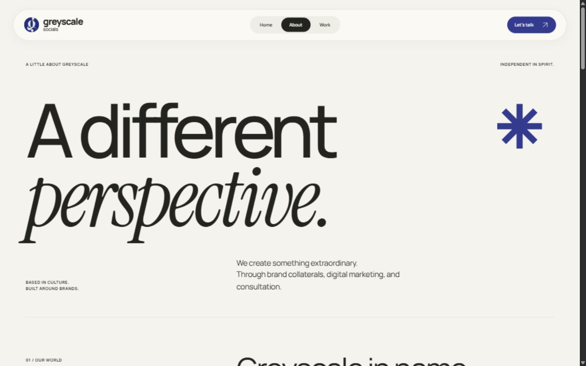
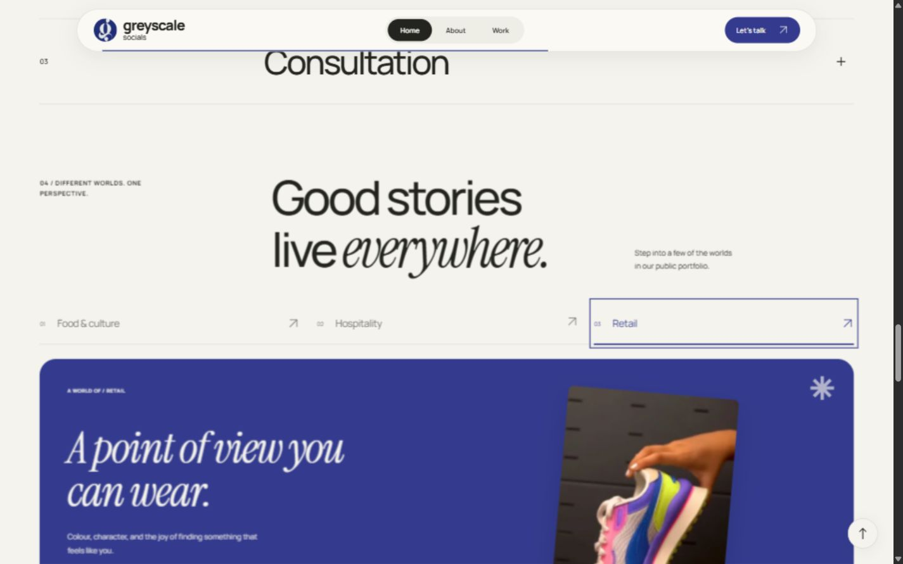
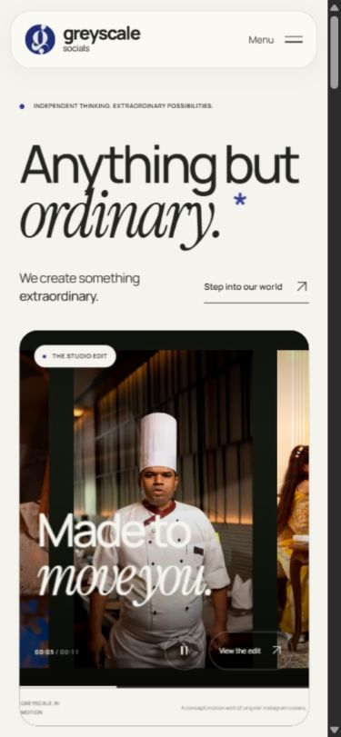
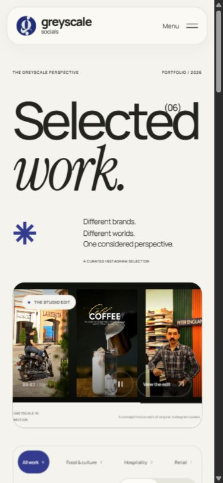
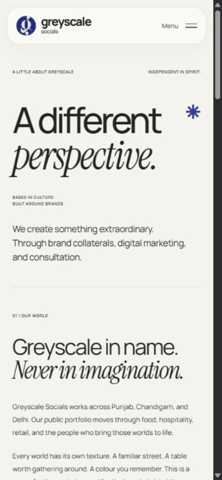
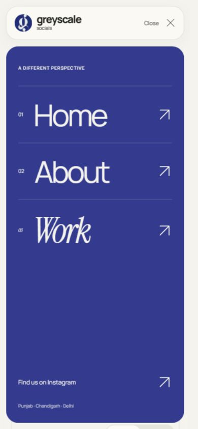
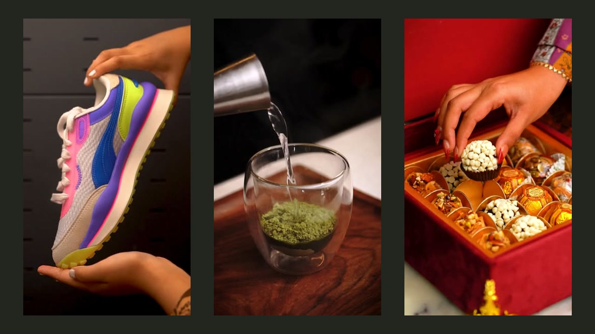

<div align="center">

<br />

**GREYSCALE SOCIALS**

# Anything but ordinary.

An editorial portfolio concept for a creative studio.<br />
Expressive typography. Authentic imagery. Motion with intention.

<br />


[The experience](#the-experience) · [Screenshots](#screenshots) · [Run locally](#run-locally) · [Demo walkthrough](#a-55-second-walkthrough) · [Asset handoff](docs/HANDOFF.md)

<br />



</div>

## The experience

A complete three-page Next.js portfolio designed for a cinematic client demonstration. Warm ivory, charcoal and a restrained indigo accent frame real imagery from the studio’s public Instagram presence. Manrope and Instrument Serif bring together a precise grid and expressive editorial details.

| Page | What to explore |
| :--- | :--- |
| **Home** `/` | Sequenced typography, an autoplay concept film, an interactive contact sheet, selected work, portfolio worlds and studio capabilities. |
| **Work** `/work` | Six project groups, category filters, Gallery and Index views, and fullscreen project presentations with image navigation. |
| **About** `/about` | An editorial studio introduction, large-format imagery, a proposed creative philosophy and a collaboration sequence. |

**The details that make it feel considered:**

- A floating, rounded navigation capsule with active routes, reading progress and a compact scroll state.
- A silent, locally hosted film with muted autoplay, pause/resume and an expanded player. Playback pauses offscreen, behind dialogs and when the browser tab is hidden.
- Art-directed portrait imagery, restrained reveals, subtle pointer movement and polished route entrances.
- Keyboard-accessible filters, tabs, mobile navigation and project dialogs with focus restoration and Escape dismissal.
- Deliberate mobile layouts, reduced-motion support, local fonts and no runtime dependency on an external media service.

## Screenshots

Actual captures of the running application. Select an image to inspect it at full size.

| Work · gallery | Work · interactive index |
| :---: | :---: |
| [](docs/screenshots/work-desktop.png) | [](docs/screenshots/work-index-desktop.png) |

| About · studio story | Home · portfolio worlds |
| :---: | :---: |
| [](docs/screenshots/about-desktop.png) | [](docs/screenshots/portfolio-worlds-desktop.png) |

<details>
<summary><strong>Made for small screens, too</strong> — Home, Work, About & navigation</summary>
<br />

<table>
  <tr>
    <td align="center"><strong>Home</strong></td>
    <td align="center"><strong>Work</strong></td>
    <td align="center"><strong>About</strong></td>
    <td align="center"><strong>Menu</strong></td>
  </tr>
  <tr>
    <td></td>
    <td></td>
    <td></td>
    <td></td>
  </tr>
</table>

</details>

## Run locally

Requires **Node.js 20.9+** and npm.

```bash
git clone https://github.com/PRABHMANNAT/greyscalesocials-freelance-project-demo.git
cd greyscalesocials-freelance-project-demo
npm ci
npm run dev
```

Open **[127.0.0.1:3000](http://127.0.0.1:3000)**. No environment variables, database or accounts are needed. The server binds to the local machine.

For the smoothest screen recording, stop the development server and run the production build:

```bash
npm run build
npm run start
```

| Command | Purpose |
| :--- | :--- |
| `npm run dev` | Start local development |
| `npm run build` | Create the production build |
| `npm run start` | Serve the production build |
| `npm run lint` | Run ESLint |
| `npm run typecheck` | Check TypeScript without emitting files |

## Built with care

**Next.js App Router · React · TypeScript · custom CSS · native browser media & dialogs**

Motion uses CSS transforms, opacity, intersection observation and native browser capabilities. Fonts and portfolio media are served locally. The application has no backend, CMS or animation-library dependency.

```text
src/
  app/                 Home, About, Work, layout & visual system
  components/          Navigation, film, gallery, motion & studio sections
  lib/projects.ts      Editable project data, categories & media sources
public/assets/
  brand/               Profile mark & font licenses
  hero/                Film poster
  projects/            Full-resolution asset handoff folder
  reels/               Concept film & provenance
  about/               Studio photography handoff folder
  thumbnails/          Original public reel covers
  asset-manifest.json  Sources, dimensions, intended use & missing media
scripts/
  build-motion-edit.mjs Local film generation script
docs/
  screenshots/         Desktop & mobile previews
  HANDOFF.md           Brand research, media requirements & implementation notes
```

### Editing the portfolio

Project names, categories, colours, images and source links live in [`src/lib/projects.ts`](src/lib/projects.ts). Add approved images to `public/assets/projects/`, then update the corresponding media entry. An optional `video` path enables a native video presentation:

```ts
{
  src: "/assets/thumbnails/reel-01.jpg",
  video: "/assets/reels/reel-01.mp4",
  alt: "Describe the approved project image",
  width: 1080,
  height: 1920,
  source: "https://www.instagram.com/greyscalesocials.in/",
  date: "YYYY-MM-DD", // Use the verified publication date.
}
```

### The concept film

The **11-second, 1280 × 720, silent H.264 film** is a locally composed motion edit of nine genuine Instagram cover images. It is labelled as a concept edit in the site; it is not original studio reel footage.

[](public/assets/reels/studio-cover-edit.mp4)

[View the MP4](public/assets/reels/studio-cover-edit.mp4) · [View source provenance](public/assets/reels/studio-cover-edit-provenance.json)

To regenerate the film, install FFmpeg and run `node scripts/build-motion-edit.mjs`. FFmpeg is only needed to rebuild this asset, never to run the website.

## A 55-second walkthrough

| Time | Scene |
| :--- | :--- |
| **00–08** | Reload Home at 1440 × 900. Let the title reveal settle, then scroll into the autoplay film. |
| **08–15** | Expand the film, allow a composition change, then close it. |
| **15–26** | Explore selected work, the indigo studio statement and another portfolio world. |
| **26–40** | Open Work. Switch to Index, select Retail, open Countryside and select another thumbnail. |
| **40–49** | Visit About and scroll through the editorial imagery and collaboration chapter. |
| **49–55** | End on the “Let’s make something matter” footer. |

## Verification

Local validation completed with **ESLint, TypeScript and a production build passing**. All three production routes returned HTTP 200, and the final browser session had no console errors or warnings.

Responsive checks covered **320, 390, 768, 1280, 1440 and 1920px** with no horizontal page overflow observed. Browser checks included autoplay, playback controls, filters, Gallery/Index switching, project navigation, dialogs, mobile navigation and service accordions. Reduced-motion styles are implemented; OS-level preference emulation was unavailable in the browser tools. These are local verification results, not an automated CI status.

## Media, credits & concept status

This is a **client acquisition concept**, prepared for a local screen recording. The source repository is shared at the owner’s request; no production site has been deployed.

- Research is based on [Greyscale Socials’ exact public Instagram profile](https://www.instagram.com/greyscalesocials.in/), inspected on 18 October 2026.
- The repository includes **12 authentic public reel covers** and the small profile mark. Each cover retains its original source link. No unrelated stock imagery, fake clients, results or testimonials are used.
- Headlines, short project labels, philosophy and process are **proposed website copy**. They are not verified client slogans or established studio practices.
- The current covers are low-resolution previews. **Approved full-resolution project images, original reels, a vector logo and optional studio photographs are still needed** for the final client recording. Exact folders and filenames are listed in the [asset handoff](docs/HANDOFF.md#original-media-needed-before-recording-the-final-client-demo).
- Third-party imagery and brand marks remain the property of their respective owners. This repository does not grant a license to reuse them. Manrope and Instrument Serif are locally hosted under their included SIL Open Font Licenses.

**Further reading:** [Asset manifest](public/assets/asset-manifest.json) · [Detailed handoff & research](docs/HANDOFF.md) · [Manrope license](public/assets/brand/Manrope-OFL.txt) · [Instrument Serif license](public/assets/brand/Instrument-Serif-OFL.txt)

<br />

<div align="center">
  <sub>GREYSCALE SOCIALS · A DIFFERENT PERSPECTIVE.</sub>
</div>
